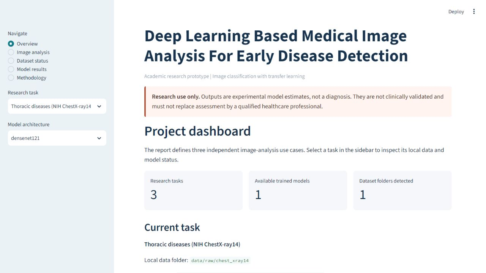
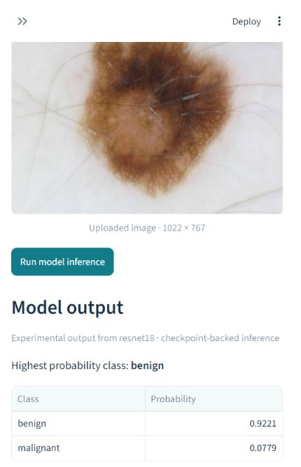
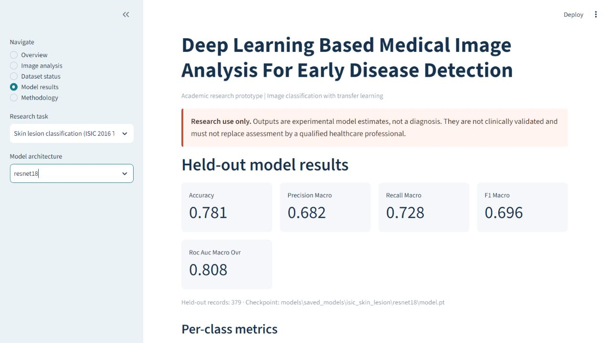

# Deep Learning Based Medical Image Analysis For Early Disease Detection

This repository implements a research prototype based on the supplied Phase-I project report. The report scopes three separate 2D image-analysis cases: thoracic findings in chest X-rays, diabetic-retinopathy grading in retinal fundus images, and skin-lesion classification in dermoscopic images. The application uses trained local checkpoints for predictions; it does not fabricate outputs when data or checkpoints are missing.

> **Academic research only.** The software is not clinically validated and does not diagnose disease. Model outputs must not replace a qualified clinician's assessment.

## Objectives

- Build transfer-learning image classifiers for the three modalities named in the report.
- Use dataset metadata and patient/lesion grouping to reduce split leakage where identifiers exist.
- Evaluate actual held-out predictions with accuracy, precision, recall, F1, sensitivity, specificity, ROC-AUC, and confusion matrices where the task supports them.
- Offer image upload, probability output, and optional Grad-CAM attention visualizations.
- Keep medical images, identifiers, and temporary experiment records local by default; publish the audited ISIC summary, metrics, history and plots needed by the app, plus its trained inference checkpoint.

## Current implementation status

The supplied report is Phase I and contains objectives, literature review, scope, feasibility, and references. It does not choose a final backbone, prescribe split ratios/hyperparameters, set performance targets, or report experiments. The official ISIC 2016 Task 3 CC0 release has been obtained and audited; exact duplicate training copies were removed to avoid split leakage. A ResNet-18 transfer-learning experiment completed 8 epochs with a validation-selected checkpoint and evaluation on the untouched official test split. Its stored metrics were independently recomputed from the checkpoint and recorded split with an exact match. NIH ChestX-ray14 remains unavailable because the full release exceeds available workspace storage alongside current files. APTOS 2019 files are absent, and the user currently cannot access Kaggle to accept the competition rules and download them.

Read [`IMPLEMENTATION_CHECKLIST.md`](IMPLEMENTATION_CHECKLIST.md) for the requirement mapping and unresolved dataset inputs.

## Dataset sources and handling

The report names these sources:

| Research task | Source named in report | Adapter expectations |
|---|---|---|
| Thoracic disease classification | NIH ChestX-ray14 | Metadata CSV containing `Image Index` and `Finding Labels`; image files are searched recursively. Labels are parsed as multi-label findings. |
| Diabetic retinopathy grading | Kaggle APTOS Retinopathy | `train.csv` with `id_code` and `diagnosis`, plus labeled images. The adapter uses the five 0-4 severity grades described by the APTOS 2019 competition page. |
| Skin lesion classification | Official ISIC 2016 Challenge Task 3 | 900 training and 379 official test images; binary benign/malignant labels; CC0; four duplicate training copies removed. |

The selected ISIC files are downloaded from the [official ISIC Challenge data page](https://challenge.isic-archive.com/data/) and listed as CC0. This is a report-compatible subset choice because the Phase-I report names ISIC but not a release. NIH and APTOS source instructions and terms remain documented; Kaggle requires sign-in and accepting competition rules. See [NIH Clinical Center dataset download](https://nihcc.app.box.com/v/ChestXray-NIHCC), [APTOS 2019 dataset page and rules](https://www.kaggle.com/competitions/APTOS2019-blindness-detection/data), and [ISIC Challenge data](https://challenge.isic-archive.com/data/).

See [`data/README.md`](data/README.md) for local layouts and audit commands. Raw datasets, private images, and credentials are never committed. This repository includes the single trained ISIC ResNet-18 checkpoint (44,785,931 bytes) so the shipped app can run actual inference for the completed task; other checkpoints and generated training records remain ignored. The checkpoint contains model weights and experiment metadata, not patient image records.

## Methodology

The Phase-I report discusses CNNs, ResNet, DenseNet, and U-Net, and proposes transfer learning from pre-trained CNN models. This implementation makes ResNet-18, ResNet-50, and DenseNet-121 configurable classification backbones. A configured choice is an implementation option, not a claim that the report selected a winner. Thoracic labels use a multi-label sigmoid/BCE objective; APTOS and manifest-defined ISIC labels use multiclass softmax/cross-entropy. Class weights are calculated from the training partition only. The model is selected by validation loss and the test partition is evaluated after training.

Where patient or lesion IDs are available, records are split as groups. The APTOS adapter has no assumed patient identifier; it uses deterministic class-stratified image-level splits and reports this limitation. The split manifest stores relative image names and hashed group IDs rather than absolute paths or raw group IDs.

Grad-CAM can be shown for supported classifiers. It is an attention visualization, **not a lesion segmentation mask** or a clinically validated explanation. U-Net is not included in the training path because the report does not specify a segmentation target or supply segmentation masks.

## Repository structure

```text
app.py                         Streamlit research application
audit_data.py                  Dataset readability, dimensions, duplicates, labels
prepare_isic2016.py            ISIC 2016 extraction, manifest and duplicate/leakage audit
train.py                       Task-specific training and held-out evaluation
config.py                      Paths and explicit reproducible defaults
src/
  data/                        ChestX-ray14, APTOS, ISIC adapters and split logic
  datasets.py                  PyTorch image dataset wrapper
  preprocessing.py             Shared validation and image transforms
  models.py                    ResNet/DenseNet transfer-learning registry
  training.py                  Validation-selected training and checkpointing
  evaluation.py                Classification metrics
  prediction.py                Checkpoint loading and image inference
  explainability.py            Optional Grad-CAM visualization
  pipeline.py                  End-to-end experiment orchestration
  visualizations.py            Results figures from actual experiment files
tests/                         Unit and mechanics-only integration tests
data/raw/                      Local datasets (ignored by Git)
models/saved_models/           ISIC ResNet-18 checkpoint tracked; other checkpoints ignored
reports/generated/             Selected ISIC evidence tracked; other outputs ignored by Git
Phase_III_Project_Submission/  Academic reports and demonstration materials
```

## Requirements and setup

Use Python 3.10 or 3.11. PyTorch/torchvision should be installed as a compatible pair for your operating system and accelerator. The `requirements.txt` lists the project packages; install the matching PyTorch build first if the default resolver does not support your GPU.

The Phase III PDFs can be regenerated from the saved ISIC experiment artifacts with `python generate_phase3.py`. Install the optional PDF generator dependency with `python -m pip install -r requirements-docs.txt` first.

```bash
python -m venv .venv
# Windows PowerShell
.venv\Scripts\Activate.ps1
python -m pip install --upgrade pip
python -m pip install -r requirements.txt
```

ImageNet weights are requested by default and may download on the first training run. If network access is unavailable, provide cached weights or explicitly use `--no-pretrained`; that run is not transfer learning and must be labeled accordingly in any report.

## Audit, train, test

Place the local data according to [`data/README.md`](data/README.md), then audit it:

```bash
python audit_data.py --task chest_xray14 --hash-images
python audit_data.py --task aptos_retinopathy --hash-images
python audit_data.py --task isic_skin_lesion --data-root data/raw/isic2016 --manifest metadata.csv --hash-images
```

Hashing all images reads every file and can take time. Run one task at a time. The audit records image readability, dimension counts, class frequencies, missing references, and byte-identical duplicates.

Train a task/model after checking the audit report:

```bash
python train.py --task chest_xray14 --architecture densenet121
python train.py --task aptos_retinopathy --architecture resnet50
python train.py --task isic_skin_lesion --data-root data/raw/isic2016 --manifest metadata.csv --architecture resnet18 --epochs 8 --batch-size 8 --augment
```

Use `--data-root` for a non-default location, `--manifest` for a custom ISIC manifest, and explicit `--epochs`, `--batch-size`, `--learning-rate`, and `--seed` values for reproducible runs. No dataset-specific experiment should be run until its actual classes, image counts, license metadata, and split coverage have been checked.

## Run the application

```bash
streamlit run app.py
```

The application offers overview, image analysis, dataset status, model results, and methodology screens. It previews valid uploads and only predicts when a real checkpoint exists for the selected task/backbone. The maximum accepted image size is 20 MB. Uploaded image bytes are kept in memory by the application code.

## Tests

```bash
python -m pytest
```

The tests include mechanics-only fixtures made from generated images for loading, preprocessing, output shape, checkpoint reload, metric calculations, grouped splits, and one-epoch training. They are not medical examples or performance evidence. The latest run passed 13 tests (`pytest -q --basetemp=.pytest-tmp`); compilation and dependency checks passed. The ISIC integration and 8-epoch experiment were also run against the actual selected dataset. NIH/APTOS data integration remains pending source access.

## Evaluation and interpretation

For multiclass tasks, the pipeline reports accuracy, macro precision/recall/F1, one-vs-rest ROC-AUC, per-class sensitivity/specificity, and a confusion matrix. For the multi-label chest task it reports subset accuracy, macro precision/recall/F1, per-label sensitivity/specificity/ROC-AUC, and per-label confusion matrices. ROC-AUC is `null` when the held-out set lacks either class for a label. Model comparison must use the same dataset release and split policy; published literature results are context, not this project's measured scores.

## Limitations and future work

- NIH ChestX-ray14 and APTOS 2019 are not installed. The approved report gives no exact releases. APTOS is gated on Kaggle rule acceptance, which the user currently cannot complete. Full NIH download is blocked by local storage capacity (about 49.8 GB free at the latest check).
- ISIC uses official 2016 Task 3 binary benign/malignant labels. The label files provide no patient identifiers, so patient-level separation cannot be verified; the official test split is preserved and byte-identical training copies are removed.
- ISIC 2016 ResNet-18 results are documented in `Phase_III_Project_Submission/Performance Results.pdf`; selected non-identifying audit, metrics, history and plots are versioned under `reports/generated/isic_skin_lesion/` so the app can display measured results after cloning. Other generated artifacts remain ignored. The trained checkpoint is included for reproducible inference; original medical images are not committed. NIH/APTOS runs, public deployment, and actual MOV recording remain pending.
- Grad-CAM is not a localization ground truth and does not establish causal explanation.
- Dataset shift, label noise, imbalance, and class-specific coverage can affect results. Clinical testing, governance, and regulatory review are outside this academic prototype.

The actual ISIC 2016 dataset is audited and trained. To extend the report's other two research tasks, provision sufficient disk space for NIH and accept/download APTOS through the user's own Kaggle account, then audit and run their experiments. No diagnostic or clinical performance claim is made here.

## Measured ISIC 2016 results

Single ImageNet-pretrained ResNet-18 run, seed 42, 8 epochs. The official ISIC test partition (379 images; 304 benign, 75 malignant) was preserved for final evaluation and not used for checkpoint selection. The best checkpoint was selected by validation loss (0.6302).

| Metric | Test result |
|---|---:|
| Accuracy | 0.7810 |
| Macro precision | 0.6817 |
| Macro recall / sensitivity | 0.7279 |
| Macro F1 | 0.6965 |
| Macro ROC-AUC (one-vs-rest) | 0.8076 |
| Malignant precision / sensitivity / F1 | 0.4615 / 0.6400 / 0.5363 |

Only one backbone was trained, so there is no comparative winner. The malignant class has materially lower precision and F1; the output is experimental and not a clinical result.

## Application screenshots

These are captures from the working local Streamlit application, including actual checkpoint-backed model output.







